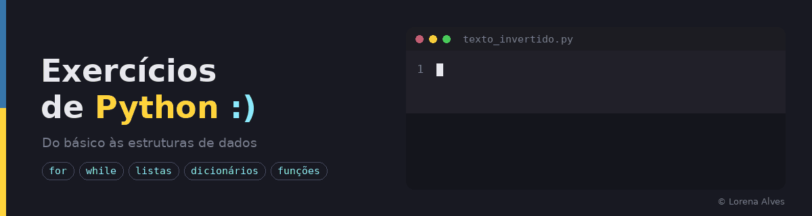

   
Exercícios que resolvi durante o curso de **Sistemas de Informação** e em cursos presenciais, organizados por assunto na ordem em que fui aprendendo, do básico (operadores e condicionais) até estruturas de dados e funções.

Cada arquivo traz o enunciado do exercício em comentário no topo, com a minha solução abaixo.

## Índice

| # | Pasta | Resumo |
|---|---|---|
| 01 | [Operadores matemáticos](01-operadores-matematicos/) | Cálculos com `+ - * / **` e fórmulas |
| 02 | [Condicionais](02-condicionais/) | Tomada de decisão com `if/elif/else` e `match/case` |
| 03 | [Laços `for`](03-lacos-for/) | Repetição com número definido de vezes |
| 04 | [Laços `while`](04-lacos-while/) | Repetição controlada por condição |
| 05 | [Listas](05-listas/) | Armazenar, percorrer e fatiar sequências de dados |
| 06 | [Matrizes](06-matrizes/) | Listas de listas: linhas, colunas e posições |
| 07 | [Dicionários](07-dicionarios/) | Dados no formato chave → valor |
| 08 | [Tratamento de erros](08-tratamento-de-erros/) | Proteger o programa com `try/except` |
| 09 | [Mini-projetos](09-mini-projetos/) | Programas que combinam vários conceitos |
| 10 | [Strings](10-strings/) | Manipulação de textos |
| 11 | [Funções](11-funcoes/) | Organizar o código em blocos reutilizáveis com `def` |

---

### 01 · [Operadores matemáticos](01-operadores-matematicos/)
Uso de operadores aritméticos e fórmulas.
- `volume_area_esfera.py`: calcula volume e área de uma esfera a partir do raio
- `reajuste_salarial.py`: aplica um reajuste percentual a um salário

### 02 · [Condicionais](02-condicionais/)
Programas que seguem caminhos diferentes conforme a entrada.
- `positivo_negativo.py`: diz se um número é positivo ou negativo
- `vogal_ou_consoante.py`: identifica se a letra digitada é vogal ou consoante
- `calculo_imc.py`: calcula o IMC e classifica a faixa de peso
- `pedido_lanchonete.py`: calcula o valor de um pedido a partir do código do lanche
- `doacao_de_sangue.py`: verifica se a pessoa pode doar sangue (condicionais aninhadas)
- `categoria_por_idade.py`: define a categoria de um jogador pela idade
- `dia_da_semana.py`: converte um número de 1 a 7 no dia da semana (`match/case`)

### 03 · [Laços `for`](03-lacos-for/)
- `soma_1_a_100.py`: soma os números de 1 a 100
- `maior_menor_peso.py`: encontra o maior e o menor peso digitados
- `analise_grupo_pessoas.py`: média de idade, homem mais velho e mulheres com menos de 20 anos

### 04 · [Laços `while`](04-lacos-while/)
- `fatorial.py`: calcula o fatorial de um número
- `fibonacci.py`: mostra os *n* primeiros termos da sequência de Fibonacci
- `conversao_temperatura.py`: converte Celsius em Fahrenheit até uma condição de parada
- `soma_ate_zero.py`: soma números até o usuário digitar 0
- `tabuada.py`: gera a tabuada da operação escolhida

### 05 · [Listas](05-listas/)
- `lista_numeros.py`: adiciona números a uma lista até digitar um negativo
- `fatiamento_de_lista.py`: intervalos, pares, ímpares e lista reversa com fatiamento
- `posicao_dos_numeros.py`: mostra cada número com sua posição (`enumerate`)
- `media_das_notas.py`: lê notas e calcula a média
- `maior_menor_numero.py`: maior e menor valor de uma lista com `max` e `min`
- `consumo_de_carros.py`: carro mais econômico e litros gastos em 1.000 km

### 06 · [Matrizes](06-matrizes/)
- `matriz_3x4_maiores_que_20.py`: valores maiores que 20 e suas posições
- `matriz_4x3_soma_linhas_colunas.py`: soma de cada linha e de cada coluna
- `matriz_4x4_pares_e_impares.py`: troca pares por 1 e ímpares por 0
- `matriz_5x2_maior_por_linha.py`: maior valor de cada linha
- `matriz_5x5_soma_media_maior.py`: soma, média e maior valor da matriz

### 07 · [Dicionários](07-dicionarios/)
- `adicionar_modificar_acessar.py`: adiciona, altera e acessa chaves
- `adicionar_ou_atualizar.py`: insere ou atualiza um par informado pelo usuário
- `buscar_chave.py`: verifica se uma chave existe
- `buscar_por_valor.py`: encontra as chaves que têm determinado valor
- `cadastro_nome_idade.py`: monta um dicionário com 5 pessoas
- `chaves_e_valores_em_listas.py`: separa chaves e valores em listas
- `contar_pares.py`: função que conta os pares chave-valor
- `exibir_chave_valor.py`: exibe os pares no formato `chave=valor`
- `inverter_dicionario.py`: troca chaves por valores
- `mesclar_somando_valores.py`: junta dois dicionários somando valores de chaves iguais
- `remover_chave.py`: remove um par pela chave
- `renomear_chave.py`: renomeia uma chave mantendo o valor
- `valores_repetidos.py`: verifica se há valores repetidos

### 08 · [Tratamento de erros](08-tratamento-de-erros/)
- `divisao_segura.py`: divisão que trata divisão por zero e entradas inválidas

### 09 · [Mini-projetos](09-mini-projetos/)
- `calculadora.py`: calculadora das quatro operações com tratamento de erros
- `jokenpo.py`: pedra, papel e tesoura contra o computador (`random`, `time`)
- `jogo_par_ou_impar.py`: par ou ímpar contra o computador até perder (`random`)
- `urna_eletronica.py`: simulação de votação com códigos de abertura e encerramento

### 10 · [Strings](10-strings/)
- `palindromo.py`: verifica se uma palavra é palíndromo
- `quatro_primeiras_letras.py`: exibe as 4 primeiras letras de um nome
- `nome_comeca_com_a_ou_e.py`: exibe o nome só se começar com "a" ou "e"
- `remover_vogais.py`: remove as vogais de um texto
- `texto_invertido.py`: inverte um texto
- `contar_e_substituir_vogais.py`: conta as vogais e as substitui por outro caractere
- `trocar_letra.py`: troca todas as ocorrências de uma letra por outra

### 11 · [Funções](11-funcoes/)
- `aceleracao.py`: calcula a aceleração de um corpo
- `area_volume_esfera.py`: área e volume da esfera com `math.pi`
- `volume_lata.py`: volume de uma lata cilíndrica
- `celsius_para_fahrenheit.py`: conversão de temperatura

---

## Como executar

É preciso ter o [Python 3](https://www.python.org/downloads/) instalado (para `match/case`, versão 3.10 ou superior).

```bash
python 02-condicionais/calculo_imc.py
```

## Prática:

`input` / `print` · f-strings · `if/elif/else` · `match/case` · `for` · `while` · listas · matrizes · dicionários · strings · funções · `try/except` · bibliotecas `random`, `time` e `math`
